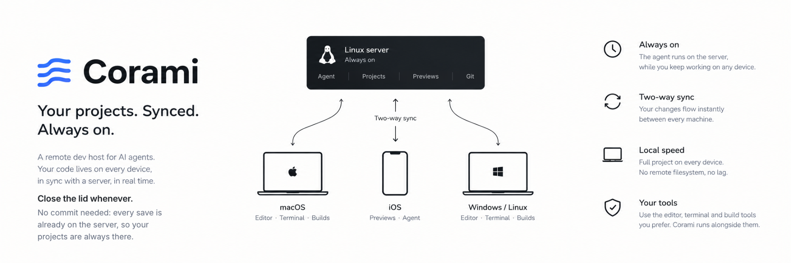

# Corami



Coding agents need a machine that never sleeps. You need the code on the computer in front of you. Corami gives you both: the agent runs on an always-on Linux server, and each of your computers keeps a real copy of the code on its own disk, synced with the server in both directions.

Corami is the host, not the agent: you install OpenCode, Claude Code, Codex or any other harness on the server.

## A day with Corami

1. At your desk, you give the agent a task. Its edits show up in the project folder on your Mac as it saves them. You follow them in your editor, and tests and Xcode run at local speed, with no remote filesystem.
2. The agent needs the iOS simulator: it runs `corami exec --on macbook -- flutter run -d "iPhone 16"`, the Mac asks you once in a dialog, and the app builds in the synced copy on the Mac.
3. Time to leave: close the lid, no commit needed. Your last saves are already on the server, and the agent keeps working there.
4. On the train, you open the preview on your phone and keep talking to the agent: the Next.js dev server runs on the server, and `corami serve 3000` gave it a stable HTTPS address, so it can stay in your bookmarks.
5. Back at your desk, you open the lid: what the agent did while you were away syncs to the Mac by itself.
6. On another computer, `corami project add ~/dev/myapp --from-server --name myapp` brings the same files, uncommitted work included.

## Try it

You need a Linux server (a small VPS is fine), a [Tailscale](https://tailscale.com) account, free for personal use, and a laptop.

```bash
# on the server, as root
curl -fsSL https://github.com/tapeo/corami/releases/latest/download/install.sh | sh

# on the laptop, signed in to the same Tailscale account
curl -fsSL https://github.com/tapeo/corami/releases/latest/download/install.sh | sh

# copies the project to the server, which becomes the source of truth:
# the folder stays here, in sync with the copies on your other machines
corami project add ~/dev/myapp
```

The [quick start](docs/quickstart.md) goes through it step by step, then adds your agent and a preview you open from the phone.

## How it works

```
                 ┌──────────────── Linux server (always on) ────────────────────┐
                 │ corami daemon · projects (source of truth) · previews        │
                 │ your agent                                                   │
                 └──────▲──────────────────▲────────────────────▲───────────────┘
                        │ Tailscale        │ Tailscale SSH      │
                        │ (HTTPS)          │ (Mutagen)          │
   phone ───────────────┘      macOS ──────┘       Linux/Windows┘
   browser: agent UI,           synced copy,         synced copy,
   previews                     builds (Xcode)       builds
```

- **One binary.** `corami` is the CLI on every machine and the daemon on the server.
- **Sync.** Files travel with [Mutagen](https://mutagen.io) over Tailscale SSH. A conflict that cannot be solved without losing data is held and reported, never overwritten. Dependencies and build outputs (`node_modules`, `build`, `Pods`...) stay out of the sync and each machine regenerates them. Everything else syncs, keys and env files included: keeping a secret off the machines is a decision made in the project, not by Corami.
- **Private.** Nothing is on the public internet: the server, the agent and the previews are reachable only through your Tailscale network.
- **Builds on a client.** When only a client can do it (Xcode, a simulator, a phone on USB), the agent runs the command there with `corami exec`, after `corami exec setup` on that client. What the agent may run is decided by the permissions of the harness.
- **Scriptable.** Every command takes `--json`, the default without a terminal. `corami exec --on` is the exception: it passes the output of the command through, and collects it in the envelope only with `--json`.

## Status

Early: it works end to end on a real VPS with a macOS client. Binaries and updates come from the [GitHub releases](https://github.com/tapeo/corami/releases), and `corami update` keeps every machine current.

## Documentation

- [Quick start](docs/quickstart.md): from nothing to an agent and a preview on your phone
- [Security](docs/security.md): what to keep in place, in order of weight
- [CLI reference](docs/cli.md)
- [Previews](docs/previews.md): a dev server with an HTTPS address
- [Builds](docs/builds.md): on the server, or on a client with `corami exec`
- [Backup](docs/backup.md): what to save and how
- [Architecture](docs/architecture.md): how it is built
- [Internals](docs/internals.md): invariants the code relies on
- [Development](docs/development.md)
- [Ideas for v2](docs/v2/README.md)

## License

Corami is released under the [Functional Source License](https://fsl.software), version 1.1, with Apache 2.0 as the future license (FSL-1.1-ALv2), see [LICENSE](LICENSE). You can use, modify and share it for any purpose except offering a competing commercial product or service. Each version becomes Apache 2.0 two years after its release. Contributions are welcome under the terms in [CONTRIBUTING.md](CONTRIBUTING.md).
